# AI Fitness Brain (`AIFitCore`) — Database Schema & RLS Specification

## Overview

The PostgreSQL database is normalized across **25 tables**, all keyed by `UUID` (`gen_random_uuid()`), timestamped with `created_at` / `updated_at`, indexed on foreign keys and query predicates, and protected by **Supabase Row Level Security (RLS)**.

---

## Entity-Relationship Diagram

```mermaid
erDiagram
    PROFILES ||--o{ USER_GOALS : has
    PROFILES ||--o{ USER_PREFERENCES : configures
    PROFILES ||--o{ WORKOUT_PLANS : owns
    PROFILES ||--o{ WORKOUT_SESSIONS : logs
    PROFILES ||--o{ EXERCISE_PERFORMANCE : tracks
    PROFILES ||--o{ EXERCISE_PROGRESSION_HISTORY : evolves
    PROFILES ||--o{ NUTRITION_TARGETS : targets
    PROFILES ||--o{ FOOD_ENTRIES : logs
    PROFILES ||--o{ MEALS : plans
    PROFILES ||--o{ WEIGHT_LOGS : records
    PROFILES ||--o{ BODY_MEASUREMENTS : measures
    PROFILES ||--o{ RECOVERY_LOGS : reports
    PROFILES ||--o{ WATER_LOGS : hydrates
    PROFILES ||--o{ AI_RECOMMENDATIONS : receives
    PROFILES ||--o{ AI_CONVERSATIONS : chats
    PROFILES ||--o{ USER_ACHIEVEMENTS : unlocks

    EXERCISES ||--o{ EXERCISE_VARIATIONS : branches
    EXERCISES ||--o{ EXERCISE_INSTRUCTIONS : details
    WORKOUT_PLANS ||--o{ WORKOUT_PLAN_EXERCISES : contains
    WORKOUT_SESSIONS ||--o{ WORKOUT_SESSION_EXERCISES : includes
    WORKOUT_SESSION_EXERCISES ||--o{ EXERCISE_SETS : records
    AI_CONVERSATIONS ||--o{ AI_MESSAGES : contains
```

---

## Complete Table Catalog (25 Tables)

### 1. User Identity & Profile Layer
1. **`profiles`**: `id (UUID PK references auth.users)`, `email`, `full_name`, `date_of_birth`, `age_years`, `biological_sex`, `height_cm`, `current_weight_kg`, `target_weight_kg`, `fitness_experience`, `activity_level`, `workout_days_per_week`, `preferred_workout_duration_min`, `injuries_limitations (TEXT[])`, `medical_conditions (TEXT[])`, `onboarding_completed (BOOLEAN)`.
2. **`user_goals`**: `id`, `user_id`, `primary_goal` (`muscle_gain`, `fat_loss`, `maintenance`, `strength`, `general_fitness`, `endurance`), `secondary_goal`, `target_weight_kg`, `weekly_rate_kg`, `is_active`.
3. **`user_preferences`**: `id`, `user_id`, `preferred_training_category` (`gym`, `home`, `calisthenics`), `available_equipment (TEXT[])`, `dietary_preference`, `dietary_restrictions (TEXT[])`, `allergies (TEXT[])`, `food_budget_tier`, `cuisine_preferences (TEXT[])`, `preferred_meals (TEXT[])`, `voice_feedback_enabled`, `theme_preference`.

### 2. Exercise Catalog & Skill Pathways
4. **`exercises`**: `id`, `slug`, `name`, `category` (`gym`, `home`, `calisthenics`), `primary_muscle`, `secondary_muscles (TEXT[])`, `equipment (TEXT[])`, `difficulty_level (1..5)`, `movement_pattern`, `is_camera_supported`, `camera_analyzer_key`, `recommended_camera_view`, `default_sets`, `default_reps`, `default_rest_sec`, `calories_per_min`.
5. **`exercise_variations`**: `id`, `parent_exercise_id`, `variation_exercise_id`, `pathway_name`, `step_order`, `prerequisite_reps`, `prerequisite_form_score`, `progression_notes`.
6. **`exercise_instructions`**: `id`, `exercise_id`, `step_number`, `instruction_text`, `form_cue`, `common_mistake`.

### 3. Workout Planning, Execution & Performance
7. **`workout_plans`**: `id`, `user_id`, `name`, `description`, `category`, `goal_focus`, `difficulty_level`, `estimated_duration_min`, `target_muscles (TEXT[])`, `generated_by_ai`, `ai_rationale`, `is_active`.
8. **`workout_plan_exercises`**: `id`, `workout_plan_id`, `exercise_id`, `order_index`, `target_sets`, `target_reps`, `target_duration_sec`, `rest_duration_sec`, `notes`, `progression_suggestion`.
9. **`workout_sessions`**: `id`, `user_id`, `workout_plan_id`, `session_name`, `category`, `started_at`, `completed_at`, `duration_sec`, `total_reps`, `good_reps`, `average_form_score`, `perceived_difficulty (1..10)`, `calories_burned_est`, `status`, `notes`.
10. **`workout_session_exercises`**: `id`, `workout_session_id`, `exercise_id`, `order_index`, `completed_sets`, `target_sets`, `total_reps`, `good_reps`, `bad_reps`, `average_form_score`, `average_rom_pct`, `used_camera_trainer`.
11. **`exercise_sets`**: `id`, `workout_session_exercise_id`, `set_number`, `target_reps`, `completed_reps`, `good_reps`, `needs_correction_reps`, `weight_kg`, `duration_sec`, `rest_taken_sec`, `form_score`, `rom_score`, `rpe`, `feedback_summary (TEXT[])`.
12. **`exercise_performance`**: `id`, `user_id`, `exercise_id`, `current_level (1..5)`, `current_variation_name`, `personal_best_reps`, `personal_best_weight_kg`, `rolling_form_score`, `rolling_consistency_score`, `consecutive_successful_sessions`, `consecutive_struggle_sessions`, `last_performed_at`.
13. **`exercise_progression_history`**: `id`, `user_id`, `exercise_id`, `workout_session_id`, `previous_level`, `new_level`, `decision` (`progress`, `maintain`, `regress`), `reason_summary`, `evidence_metrics (JSONB)`.

### 4. Nutrition, Food Catalog & Intake Logs
14. **`food_items`**: `id`, `name`, `name_bn` (optional Bengali transliteration), `category`, `cuisine_tag`, `serving_size_g`, `serving_unit_label`, `calories_kcal`, `protein_g`, `carbs_g`, `fat_g`, `fiber_g`, `budget_tier`, `is_verified`.
15. **`food_entries`**: `id`, `user_id`, `food_item_id`, `logged_date`, `meal_type` (`breakfast`, `lunch`, `snack`, `dinner`), `food_name`, `entry_method` (`manual`, `text`, `voice`, `image`), `portion_grams`, `servings`, `calories_kcal`, `protein_g`, `carbs_g`, `fat_g`, `fiber_g`, `image_url`, `ai_confidence`, `user_confirmed`.
16. **`meals`**: `id`, `user_id`, `plan_date`, `meal_type`, `title`, `description`, `items_summary (TEXT[])`, `total_calories`, `protein_g`, `carbs_g`, `fat_g`, `fiber_g`, `is_customized`.
17. **`nutrition_targets`**: `id`, `user_id`, `bmr_kcal`, `tdee_kcal`, `daily_calorie_target`, `protein_target_g`, `carbs_target_g`, `fat_target_g`, `fiber_target_g`, `water_target_ml`, `formula_used`, `goal_adjustment_kcal`, `safety_warnings (TEXT[])`, `is_current`.

### 5. Body, Recovery & Hydration Memory
18. **`weight_logs`**: `id`, `user_id`, `logged_date`, `weight_kg`, `body_fat_pct`, `is_measured`, `notes`.
19. **`body_measurements`**: `id`, `user_id`, `logged_date`, `chest_cm`, `waist_cm`, `hips_cm`, `bicep_cm`, `thigh_cm`, `neck_cm`, `progress_photo_path`.
20. **`recovery_logs`**: `id`, `user_id`, `logged_date`, `sleep_hours`, `sleep_quality (1..5)`, `muscle_soreness (1..5)`, `sore_areas (TEXT[])`, `fatigue_level (1..5)`, `stress_level (1..5)`, `readiness_score (0..100)`, `is_rest_day`, `notes`.
21. **`water_logs`**: `id`, `user_id`, `logged_date`, `amount_ml`, `logged_at`.

### 6. Adaptive AI Brain, Conversations & Achievements
22. **`ai_recommendations`**: `id`, `user_id`, `module_source` (`workout`, `nutrition`, `progression`, `recovery`), `title`, `summary`, `rationale`, `priority`, `action_payload (JSONB)`, `is_applied`.
23. **`ai_conversations`**: `id`, `user_id`, `title`, `context_snapshot (JSONB)`.
24. **`ai_messages`**: `id`, `conversation_id`, `user_id`, `role` (`user`, `assistant`, `system`), `content`, `model_used`, `tokens_used`.
25. **`user_achievements`**: `id`, `user_id`, `achievement_code`, `title`, `description`, `category`, `unlocked_at`.

---

## Row Level Security (RLS) Policy Matrix

- **User-Owned Tables (`profiles`, `user_goals`, `user_preferences`, `workout_plans`, `workout_sessions`, `exercise_performance`, `exercise_progression_history`, `food_entries`, `meals`, `nutrition_targets`, `weight_logs`, `body_measurements`, `recovery_logs`, `water_logs`, `ai_recommendations`, `ai_conversations`, `ai_messages`, `user_achievements`)**:
  - `SELECT`, `INSERT`, `UPDATE`, `DELETE` restricted strictly to `auth.uid() = user_id` (or `auth.uid() = id` on `profiles`).
- **Child Junction Tables (`workout_plan_exercises`, `workout_session_exercises`, `exercise_sets`)**:
  - Restricted via `EXISTS` subquery verifying ownership of parent `workout_plan_id` or `workout_session_id` by `auth.uid()`.
- **Global Reference Catalogs (`exercises`, `exercise_variations`, `exercise_instructions`, `food_items`)**:
  - `SELECT` allowed for authenticated and anonymous readers; `INSERT/UPDATE/DELETE` restricted to service role.
