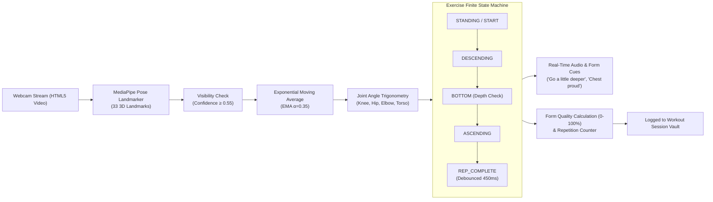

<div align="center">

# 🧠 AI FITNESS BRAIN (AIFitCore)
### Production-Minded, Real-Time Biomechanical AI Personal Trainer, Computer Vision Exercise Form Coach & Adaptive Nutrition Intelligence Platform

[](https://aifitcore.vercel.app)
[](https://nextjs.org/)
[](https://www.typescriptlang.org/)
[](https://tailwindcss.com/)
[](https://supabase.com/)
[](https://openrouter.ai/)
[](https://developers.google.com/mediapipe)
[](https://vitest.dev/)
[](./LICENSE)

<br/>

> **"Your Body. Your Goals. Your AI Personal Trainer."**  
> An intelligent fitness platform that understands human anatomy, watches your movement kinematics through your browser camera, computes exact metabolic expenditures, tracks macro adherence with Bangladeshi and international foods, and enforces evidence-based progressive overload.

<br/>

[🚀 Live Web Application](https://aifitcore.vercel.app) • [🐙 GitHub Repository](https://github.com/Shafiur0/AIFirCore) • [🏗️ System Architecture](#-system-architecture) • [📊 Database Schema](#-database-architecture--rls-security) • [📹 AI Camera Trainer](#-browser-based-ai-camera-trainer) • [⚡ Getting Started](#-getting-started)

</div>

---

## 📑 Table of Contents

1. [Product Vision & Core Principles](#-product-vision--core-principles)
2. [Complete Application Showcase (16 Modules)](#-complete-application-showcase-16-modules)
3. [System Architecture](#-system-architecture)
4. [Computer Vision Kinematic Pipeline](#-computer-vision-kinematic-pipeline)
5. [The 7 Central Intelligence Engines](#-the-7-central-intelligence-engines)
6. [Database Architecture & RLS Security](#-database-architecture--rls-security)
7. [Technology Stack](#-technology-stack)
8. [Getting Started & Local Setup](#-getting-started--local-setup)
9. [Verification & Test Suite](#-verification--test-suite)
10. [Biomechanical & Ethical AI Transparency](#-biomechanical--ethical-ai-transparency)

---

## 🎯 Product Vision & Core Principles

Most fitness apps fail because they deliver **static cookie-cutter routines**, compute **hallucinated AI calorie estimates**, or treat advanced lifters and beginners identically. 

**AI Fitness Brain (`AIFitCore`)** was engineered under five non-negotiable principles:

```
┌────────────────────────────────────────────────────────────────────────────────────────┐
│                                 CORE ARCHITECTURAL PILLARS                              │
├──────────────────────────┬──────────────────────────┬──────────────────────────────────┤
│ 1. Radical               │ 2. Deterministic Code    │ 3. 100% Client-Side Camera       │
│    Individualization     │    vs. Generative AI     │    Privacy                       │
│ No two athletes ever     │ BMR/TDEE math, rep-count │ MediaPipe 33-landmark pose       │
│ receive the same workout │ state machines, and joint│ tracking executes locally in     │
│ or calorie requirements. │ angles are 100%          │ browser memory. Zero video is    │
│ Recommendations adapt to │ deterministic and unit-  │ ever uploaded or streamed to     │
│ injuries, available gear,│ tested. LLMs never invent│ external servers or LLMs.        │
│ and recovery state.      │ metabolic numbers.       │                                  │
├──────────────────────────┴──────────────────────────┴──────────────────────────────────┤
│ 4. Independent Per-Exercise Mastery (Levels 1 to 5)                                    │
│ A user is never labeled with a single blunt "Intermediate" tag. You may be a Level 4  │
│ Squatter, a Level 2 Push-Up athlete, and a Level 1 Pull-Up beginner simultaneously.    │
├────────────────────────────────────────────────────────────────────────────────────────┤
│ 5. Multi-Session Evidence-Based Progressive Overload                                   │
│ The engine requires 2 consecutive high-quality sessions (≥82% form + full reps + good  │
│ recovery) before unlocking a progression, and guards against regression after a single │
│ tough day.                                                                             │
└────────────────────────────────────────────────────────────────────────────────────────┘
```

---

## 📱 Complete Application Showcase (16 Modules)

The application provides a cohesive, commercial-grade experience spanning 16 specialized modules designed with deep charcoal/black glassmorphic surfaces, neon electric lime accents (`#CCFF00`), and smooth Framer Motion interactions:

```text
AIFitCore Application Map (All 27 Next.js Static & Server Routes)
├── (Marketing)
│   ├── / ............................ Full-Bleed Video Hero & Live SVG Telemetry
│   └── /features .................... Deep Dive into the 7 Intelligence Engines
├── (Auth)
│   ├── /login ....................... Supabase Authenticated Sign-In
│   ├── /register .................... Account Provisioning & Security Vault
│   └── /forgot-password ............. Password Recovery Flow
└── (Dashboard Shell)
    ├── /dashboard ................... Central Command Center & Metric Rings
    ├── /onboarding .................. 5-Step Biometric, Equipment & Diet Wizard
    ├── /gym ......................... Gym Overload Tracker (Barbell/Dumbbell/Cable)
    ├── /home ........................ Equipment-Aware Home Training Module
    ├── /calisthenics ................ 5-Tier Skill Progression Tree Module
    ├── /trainer ..................... MediaPipe AI Camera Real-Time Kinematic Coach
    ├── /workouts .................... Catalog-Gated AI Workout Plan Generator
    ├── /nutrition ................... BMR/TDEE Calculator & 4-Meal Plan Generator
    ├── /food-tracker ................ 4-Mode Calorie/Macro Scanner & Water Vault
    ├── /history ..................... Long-Term Personal Training & Biometric Memory
    ├── /progress .................... Interactive Recharts Analytics & Milestones
    ├── /recovery .................... Sleep, Soreness, Fatigue & Readiness Score
    ├── /ai-coach .................... Grounded Conversational AI Fitness Coach
    └── /settings .................... Profile Editor, Data Export & Privacy Controls
```

### Module Highlights

| Section | Core Capabilities | Biomechanical / AI Integration |
|---|---|---|
| **Landing Page (`/`)** | High-energy background workout video, real-time SVG skeleton telemetry HUD, responsive navigation | Client-side video playback with interactive joint angle calculations |
| **Command Center (`/dashboard`)** | Daily calorie & macro adherence rings, active workout plan card, per-exercise mastery badges | Syncs with Recovery Readiness and live nutrition log |
| **AI Camera Trainer (`/trainer`)** | 30 FPS MediaPipe pose landmarker, rep counter, joint angle gauges, form cues, audio speech | Supports Squat, Push-up, Lunge, Plank, Bicep Curl, Shoulder Press |
| **Gym Training (`/gym`)** | Compound lift tracking, RPE-based weight increments, 1RM estimations | Progressive overload recommendations calibrated per muscle group |
| **Home Workout (`/home`)** | Minimal-gear routines filtered strictly by user-owned items (Bands, Dumbbells, Bodyweight) | Prevents prescribing equipment the user does not own |
| **Calisthenics (`/calisthenics`)** | Prerequisite-gated skill trees (Push-ups, Pull-ups, Dips, Handstands, Squats, L-sits) | Level 1 Foundation $\rightarrow$ Level 5 Elite skill unlock thresholds |
| **Workout Planner (`/workouts`)** | AI workout generation constrained to 30 verified database exercise slugs | OpenRouter JSON mode validated with Zod schema |
| **Nutrition Planner (`/nutrition`)** | Deterministic Mifflin-St Jeor / Katch-McArdle BMR/TDEE engine + 4-meal daily synthesizer | Includes authentic Bangladeshi staples (*Lal Chal*, *Rohu*, *Atta Roti*, *Dal*) |
| **Food & Calorie Tracker (`/food-tracker`)** | 4 input modes: Fast Natural Text NLP, Bangladeshi Catalog, AI Vision Photo Scan, Manual | Vision analysis requires explicit user portion confirmation before saving |
| **Fitness History (`/history`)** | Comprehensive logs of past workouts, measured weight, body circumferences, and AI audits | Long-term memory feeds the progression engine and conversational coach |
| **Progress & Analytics (`/progress`)** | Interactive Recharts visualizations (Weight trajectory, Volume vs. Form score, Skill levels) | Distinguishes between **Measured Data** and **Estimated Indicators** |
| **Recovery Tracking (`/recovery`)** | Daily readiness score ($0\text{--}100\%$) based on sleep duration, sleep quality, soreness, fatigue | Automatically scales workout volume down if readiness drops below 65% |
| **Conversational AI Coach (`/ai-coach`)** | Context-grounded assistant with instant prompt chips and live athlete database context | Injected with athlete profile, remaining daily macros, and progression logs |
| **Settings & Security (`/settings`)** | Biometric profile updater, goal modifier, password updater, GDPR-style JSON export | Complete user data export and one-click account wipe |

---

## 🏗️ System Architecture

AI Fitness Brain is built with clean architecture separating presentation, deterministic business logic, database isolation, and generative AI services:

```mermaid
flowchart TD
  subgraph Client["🖥️ Modern Client Layer (Next.js 15 App Router / React 19)"]
    UI["Glassmorphic UI / Tailwind CSS / Framer Motion"]
    CV["MediaPipe Pose Landmarker (Tasks-Vision 30 FPS)"]
    Audio["Web Speech Voice Coach & Audio Telemetry"]
    Vault["Local-First State Vault & Cache"]
  end

  subgraph Server["⚡ Server API Layer (Next.js Edge & Node.js Runtime)"]
    AuthGuard["Security & Ownership Guard / Rate Limiter"]
    ZodVal["Zod Schema Validation Pipeline"]
    
    subgraph DeterministicEngines["Deterministic Core Engines"]
      MetabolicEngine["Metabolic Engine (Mifflin-St Jeor / Katch-McArdle)"]
      OverloadEngine["Progressive Overload & Adaptive Difficulty Engine"]
      KinematicEngine["Kinematic Pose & Angle State Machines"]
      RecoveryEngine["Sleep & Readiness Scoring Engine"]
    end

    AIRoutes["/api/ai Unified Controller (Server-Side Key Protection)"]
  end

  subgraph Cloud["☁️ Cloud Infrastructure (Supabase & OpenRouter)"]
    direction TB
    SupaDB[("Supabase PostgreSQL 17\n25 Normalized Tables\nRow Level Security (RLS)")]
    SupaAuth["Supabase Auth & Session Management"]
    SupaStore["Supabase Storage (Progress Photos)"]
    OpenRouter["OpenRouter API Gateway\nopenai/gpt-4o-mini (Text & Vision)\nStructured JSON Mode"]
  end

  UI --> CV
  CV --> Audio
  UI <--> Vault
  UI <--> Server

  Server <--> AuthGuard
  AuthGuard --> ZodVal
  ZodVal --> DeterministicEngines
  ZodVal --> AIRoutes

  AIRoutes <-->|Strict Prompting & JSON Validation| OpenRouter
  Server <-->|Scoped auth.uid() Queries| SupaDB
  Server <--> SupaAuth
  Server <--> SupaStore
```

---

## 📹 Computer Vision Kinematic Pipeline

The AI Camera Trainer runs **100% locally in the user's browser**, executing real-time pose estimation and biomechanical state evaluation:



### Supported Exercises & Biomechanical Rules

| Exercise | Primary Angle | Depth Threshold | Collinearity / Form Rules Checked |
|---|---|---|---|
| **Bodyweight Squat** | Hip-Knee-Ankle | $\le 95^\circ$ for parallel | Torso forward-lean angle, knee valgus deviation, foot elevation |
| **Standard Push-Up** | Shoulder-Elbow-Wrist | $\le 90^\circ$ at bottom | Ear-Shoulder-Hip-Ankle collinearity, hip sagging, elbow flare |
| **Forward Lunge** | Hip-Knee-Ankle | $\le 95^\circ$ front knee | Rear knee ground clearance, upright torso alignment |
| **Forearm Plank** | Shoulder-Hip-Ankle | $165^\circ\text{--}180^\circ$ | Hip piking ($<160^\circ$) vs. hip sagging ($>185^\circ$), shoulder stack |
| **Dumbbell Bicep Curl** | Shoulder-Elbow-Wrist | $\le 50^\circ$ peak contraction | Upper-arm drift, elbow swing momentum, full eccentric extension |
| **Shoulder Press** | Shoulder-Elbow-Wrist | $\ge 165^\circ$ overhead lockout | Symmetrical press path, lumbar hyperextension, elbow flare |

---

## ⚙️ The 7 Central Intelligence Engines

```
  ┌──────────────────────────────────────────────────────────────────────────────────┐
  │                           7 CENTRAL INTELLIGENCE ENGINES                         │
  ├──────────────────────────────────────────────────────────────────────────────────┤
  │ 1. Workout Intelligence Engine       │ Filters catalog exercises by user gear,   │
  │    (src/services/workout/)           │ injuries, recovery readiness & levels.    │
  ├──────────────────────────────────────┼───────────────────────────────────────────┤
  │ 2. Nutrition Intelligence Engine     │ Synthesizes 4-meal daily plans honoring   │
  │    (src/services/nutrition/)         │ budget, allergies, and local staples.     │
  ├──────────────────────────────────────┼───────────────────────────────────────────┤
  │ 3. Deterministic Metabolic Engine    │ Computes BMR, TDEE, calorie targets,      │
  │    (src/lib/calculations/nutrition.ts│ macro splits, fiber, and water targets.   │
  ├──────────────────────────────────────┼───────────────────────────────────────────┤
  │ 4. Recovery & Readiness Engine       │ Computes daily Readiness Score (0-100%)   │
  │    (src/services/recovery/)          │ from sleep, soreness, fatigue & stress.   │
  ├──────────────────────────────────────┼───────────────────────────────────────────┤
  │ 5. Progress Analytics Engine         │ Evaluates weight trajectory, form score   │
  │    (src/services/analytics/)         │ trends, and multi-week consistency.       │
  ├──────────────────────────────────────┼───────────────────────────────────────────┤
  │ 6. Progressive Overload Engine       │ Evaluates per-exercise performance to     │
  │    (src/services/progression/)       │ PROGRESS, MAINTAIN, or REGRESS level.     │
  ├──────────────────────────────────────┼───────────────────────────────────────────┤
  │ 7. Grounded Conversational AI Coach  │ Context-grounded assistant with real-time │
  │    (src/lib/ai/openrouter.ts)        │ database context (macros, form, recovery).│
  └──────────────────────────────────────────────────────────────────────────────────┘
```

---

## 🗄️ Database Architecture & RLS Security

The database runs on **PostgreSQL 17** via Supabase with **Row Level Security (RLS) enabled across 100% of tables**.

```mermaid
erDiagram
  PROFILES ||--o{ USER_GOALS : "defines"
  PROFILES ||--|| USER_PREFERENCES : "configures"
  PROFILES ||--o{ WORKOUT_PLANS : "creates"
  PROFILES ||--o{ WORKOUT_SESSIONS : "logs"
  PROFILES ||--o{ EXERCISE_PERFORMANCE : "tracks"
  PROFILES ||--o{ EXERCISE_PROGRESSION_HISTORY : "audits"
  PROFILES ||--o{ FOOD_ENTRIES : "records"
  PROFILES ||--o{ MEALS : "plans"
  PROFILES ||--o{ NUTRITION_TARGETS : "calibrates"
  PROFILES ||--o{ WEIGHT_LOGS : "measures"
  PROFILES ||--o{ BODY_MEASUREMENTS : "tracks"
  PROFILES ||--o{ RECOVERY_LOGS : "evaluates"
  PROFILES ||--o{ WATER_LOGS : "logs"
  PROFILES ||--o{ AI_RECOMMENDATIONS : "receives"
  PROFILES ||--o{ AI_CONVERSATIONS : "has"
  PROFILES ||--o{ USER_ACHIEVEMENTS : "unlocks"

  WORKOUT_PLANS ||--o{ WORKOUT_PLAN_EXERCISES : "contains"
  WORKOUT_SESSIONS ||--o{ WORKOUT_SESSION_EXERCISES : "performs"
  WORKOUT_SESSION_EXERCISES ||--o{ EXERCISE_SETS : "records"
  EXERCISES ||--o{ EXERCISE_VARIATIONS : "has"
  EXERCISES ||--o{ EXERCISE_INSTRUCTIONS : "details"
  AI_CONVERSATIONS ||--o{ AI_MESSAGES : "contains"
```



### The 25 Normalized Tables

| Category | Tables | Row Level Security (RLS) Policy |
|---|---|---|
| **Identity & Goals** | `profiles`, `user_goals`, `user_preferences` | Strictly isolated: `auth.uid() = id` / `auth.uid() = user_id` |
| **Exercise Catalog** | `exercises`, `exercise_variations`, `exercise_instructions` | Public read-only: `FOR SELECT USING (true)` |
| **Workout Plans** | `workout_plans`, `workout_plan_exercises` | Owner management via `auth.uid() = user_id` and plan join |
| **Session Tracking** | `workout_sessions`, `workout_session_exercises`, `exercise_sets` | Owner management via `auth.uid() = user_id` cascading check |
| **Progression Vault** | `exercise_performance`, `exercise_progression_history` | Strictly isolated: `auth.uid() = user_id` |
| **Food & Nutrition** | `food_items` (Public Read), `food_entries`, `meals`, `nutrition_targets` | User entries isolated: `auth.uid() = user_id` |
| **Biometrics** | `weight_logs`, `body_measurements`, `water_logs` | Strictly isolated: `auth.uid() = user_id` |
| **Recovery** | `recovery_logs` | Strictly isolated: `auth.uid() = user_id` |
| **AI Memory & Coach** | `ai_recommendations`, `ai_conversations`, `ai_messages` | Strictly isolated: `auth.uid() = user_id` |
| **Milestones** | `user_achievements` | Strictly isolated: `auth.uid() = user_id` |

---

## 🛠️ Technology Stack

```
Frontend Architecture       Next.js 15.5.29 (App Router) • React 19 • TypeScript 5.7
Styling & Design            Tailwind CSS 3.4 • shadcn/ui • Lucide React Icons
Motion & Visuals            Framer Motion 12 • Recharts 2.15 • Glassmorphic Dark HUD
Computer Vision             MediaPipe Pose Landmarker (@mediapipe/tasks-vision)
Database & Authentication   Supabase • PostgreSQL 17 • Supabase Auth • Supabase RLS
AI Gateway & Models         OpenRouter API (openai/gpt-4o-mini text & vision) • Zod Validation
Testing & Quality           Vitest 3.0 • ESLint 9 • TypeScript strict checking
Deployment & Hosting        Vercel Edge & Serverless Hosting • Supabase Singapore (ap-southeast-1)
```

---

## ⚡ Getting Started & Local Setup

### 1. Prerequisites
- **Node.js**: v18.18+ or v20+ installed
- **Git**: installed and authenticated
- **Webcam**: required for AI Camera Trainer module

### 2. Clone the Repository
```bash
git clone https://github.com/Shafiur0/AIFirCore.git
cd AIFirCore
```

### 3. Install Dependencies
```bash
npm install
```

### 4. Configure Environment Variables
Copy `.env.example` to `.env.local`:
```bash
cp .env.example .env.local
```

Populate `.env.local` with your credentials:
```env
# --- Supabase Configuration ---
NEXT_PUBLIC_SUPABASE_URL=https://your-project.supabase.co
NEXT_PUBLIC_SUPABASE_ANON_KEY=your-supabase-anon-key

# --- OpenRouter AI Configuration ---
OPENROUTER_API_KEY=sk-or-v1-your-openrouter-key
OPENROUTER_MODEL=openai/gpt-4o-mini
OPENROUTER_VISION_MODEL=openai/gpt-4o-mini
OPENROUTER_COACH_MODEL=openai/gpt-4o-mini

# --- Application URL ---
NEXT_PUBLIC_APP_URL=http://localhost:3000
```

> **Local-First Note:** If you launch without Supabase credentials, AIFitCore automatically runs in **Verified Local-First Persistence Mode** using its in-memory/localStorage state vault, allowing you to test all 16 modules immediately.

### 5. Apply Supabase Migrations (If self-hosting database)
Run the SQL migration scripts in order:
```bash
# 1. 25 Normalized Tables, Triggers & Extensions
database/migrations/001_initial_schema.sql

# 2. Row Level Security Policies
database/migrations/002_rls_policies.sql

# 3. Seed 30 Exercises & Pathways
database/seeds/001_exercises.sql

# 4. Seed 23 Bangladeshi & Global Foods
database/seeds/002_foods.sql
```

### 6. Run Development Server
```bash
npm run dev
```
Open [http://localhost:3000](http://localhost:3000) in your browser.

---

## 🧪 Verification & Test Suite

The project includes an automated Vitest test suite covering all core mathematical formulas, computer-vision state machines, progression rules, and RLS ownership boundaries:

```bash
# Run unit & integration tests
npm run test

# Run strict TypeScript typecheck
npm run typecheck

# Run production build
npm run build
```

### Test Suite Coverage Summary (12/12 Tests Passing)
```
 ✓ tests/aifitcore.test.ts (12 tests) 11ms
   ✓ 1. BMR, TDEE, Daily Calorie Totals & Macro Calculations
     ✓ calculates Mifflin-St Jeor BMR accurately for male and female profiles
     ✓ uses Katch-McArdle formula when bodyFatPct is provided
     ✓ calculates TDEE and personalized macro targets with safety guardrails
     ✓ deterministically aggregates daily calorie, macro, and water totals
   ✓ 2. Computer Vision Pose State Transitions, Rep Counting & Form Rules
     ✓ transitions SquatAnalyzer through STANDING -> DESCENDING -> BOTTOM -> ASCENDING -> REP_COMPLETE
     ✓ prevents duplicate rep counting within refractory window & tests all 6 analyzers
   ✓ 3. Per-Exercise Progressive Overload & Adaptive Difficulty Engine
     ✓ progresses an exercise only after 2 consecutive high-quality sessions with adequate recovery
     ✓ never regresses a user on a single poor session; regresses after 2 consecutive struggles
   ✓ 4. RLS Access Boundaries & AI Response Validation
     ✓ enforces strict RLS ownership boundaries across user records
     ✓ validates structured AI Workout, Meal Plan, and Food Vision JSON with Zod
   ✓ 5. Workout Creation & Food Logging (Bangladeshi & Global Catalog)
     ✓ creates a personalized home workout using only equipment user owns
     ✓ searches Bangladeshi food catalog and parses natural food descriptions
```

---

## 🔒 Biomechanical & Ethical AI Transparency

1. **Estimated Indicators vs. Medical Diagnosis**:
   All movement form scores ($0\text{--}100\%$), joint angles, and metabolic rates (BMR/TDEE) are transparently labeled as **Biomechanical Estimates**. AIFitCore does not provide medical diagnoses or physical therapy prescriptions.
2. **Safety Guardrails for Minors & Underweight Athletes**:
   Users under 18 years of age or with a BMI $< 18.5$ are automatically restricted from aggressive caloric deficits; the system enforces maintenance or controlled growth targets with clear health warnings.
3. **Food Vision Portion Confirmation**:
   Because 2D smartphone photographs cannot measure true mass density or hidden cooking oils, AI vision analysis presents an **estimated candidate list with grams and calories that the user must review and confirm** before writing to their log.
4. **Client-Side Privacy Guarantee**:
   Webcam frames never leave client RAM. Video processing is executed purely on-device via WebAssembly/WebGL MediaPipe runtimes.

---

## 👨‍💻 Author & Contributions

* **Created by:** [Shafiur0](https://github.com/Shafiur0)
* **Application Name:** AI Fitness Brain (`AIFitCore`)
* **Live Deployment:** [https://aifitcore.vercel.app](https://aifitcore.vercel.app)
* **Repository:** [https://github.com/Shafiur0/AIFirCore](https://github.com/Shafiur0/AIFirCore)

Contributions, feature requests, and bug reports are welcome via GitHub Issues and Pull Requests.

---

<div align="center">
  <sub>Built with ❤️ for human health, movement mastery, and intelligent athletic longevity.</sub>
</div>
